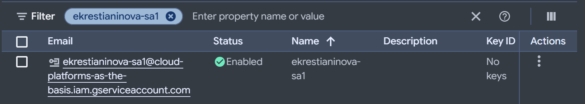
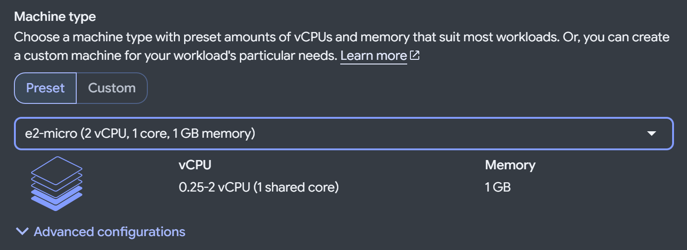
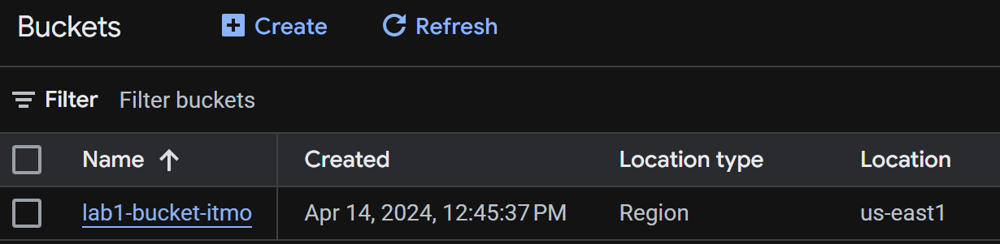
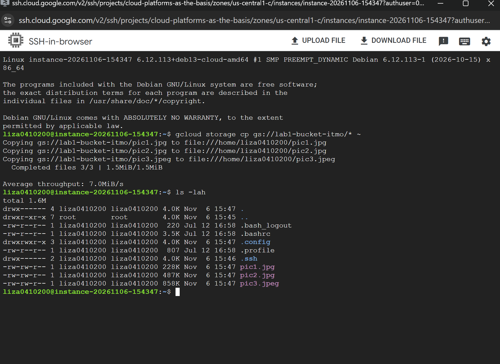
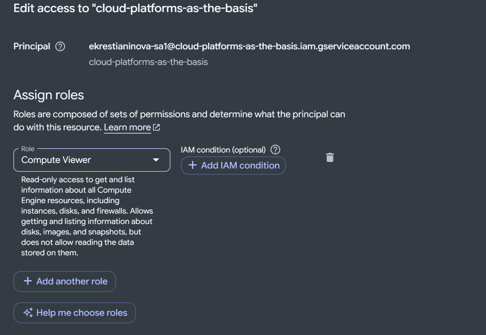
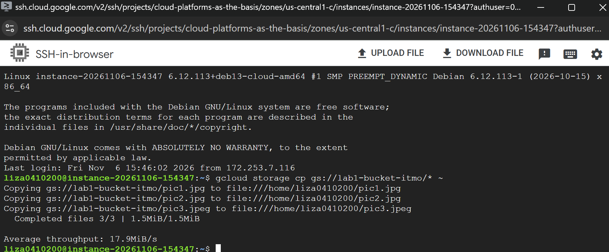

# Отчет по лабораторной работе №1 "Обзор Google Cloud и исследование основных сервисов"

## Подготовка

Создаем Service Account и Compute engine

## Работа с бакетом

Находим название бакета в веб интерфейсе

Подключаемся через ssh к машине и копируем файлы из бакета с помощью утилиты gcloud 

Меняем права Serivce account и повторяем копирование

Копирование успешно выполнилось в связи с тем что на виртуалку мы подключались не под сервис аккаунтом а под аккаунтом гугла, с которого мы залогинины в гугл клауд, у которого стоят админские права