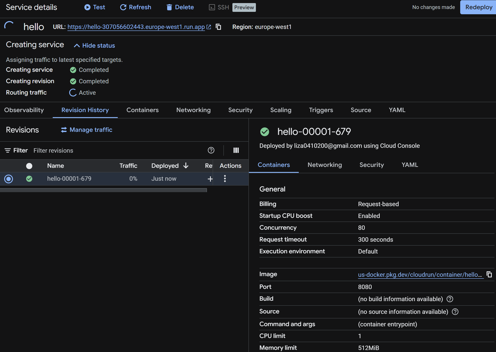
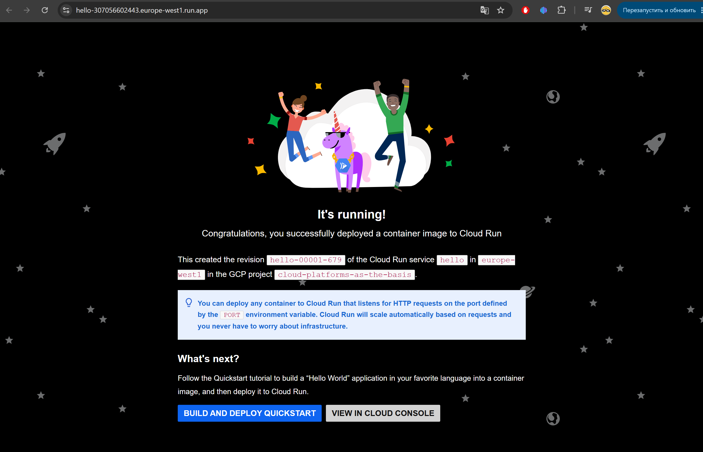
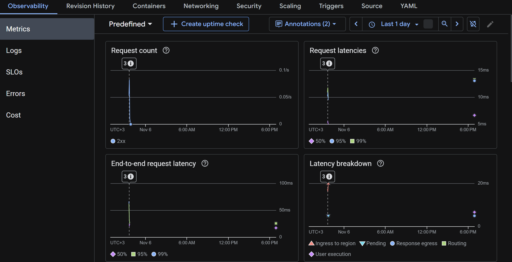
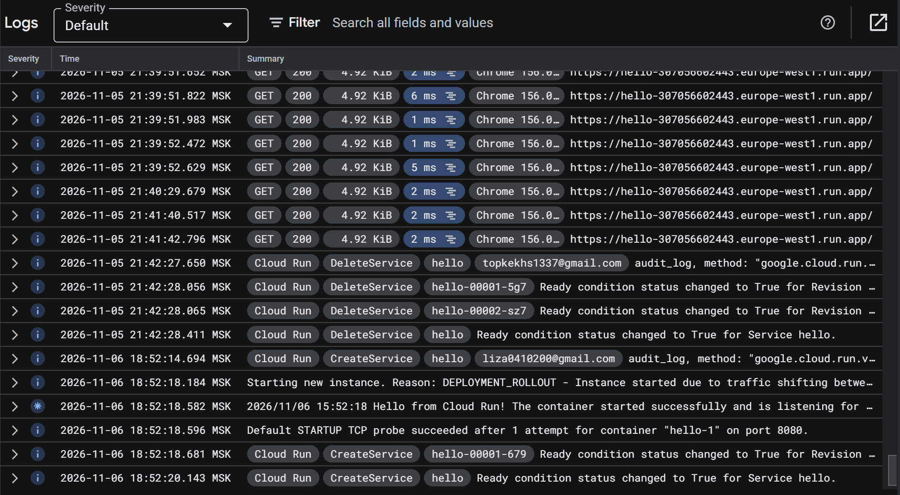
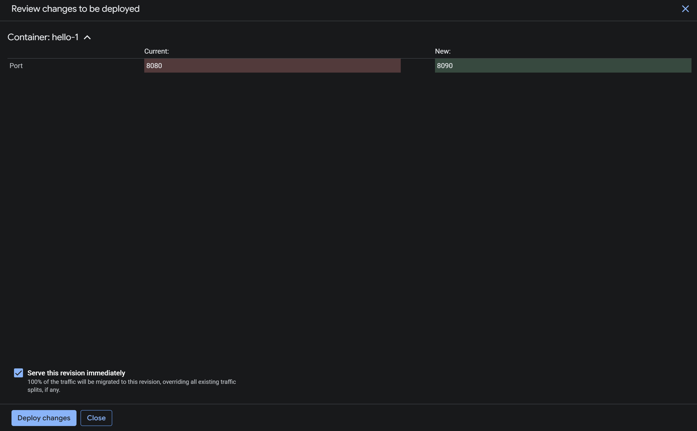
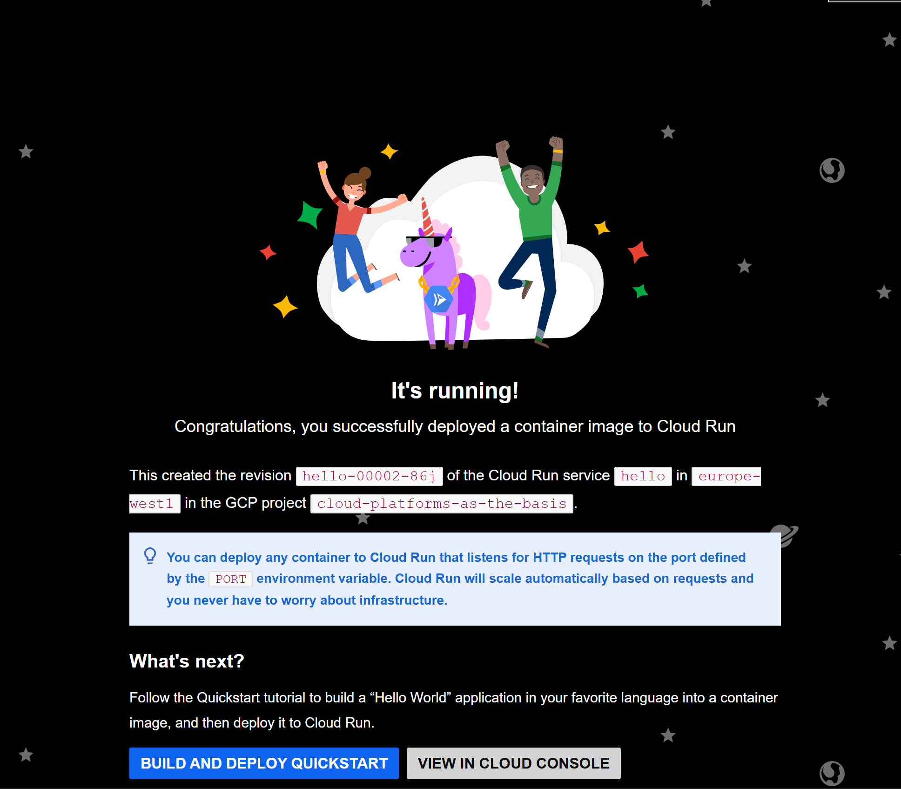
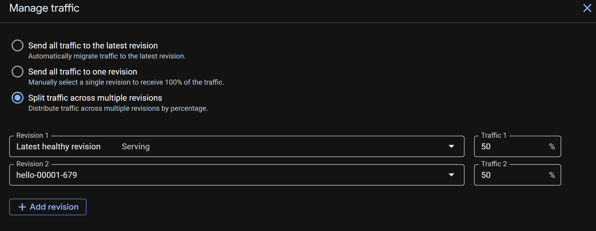
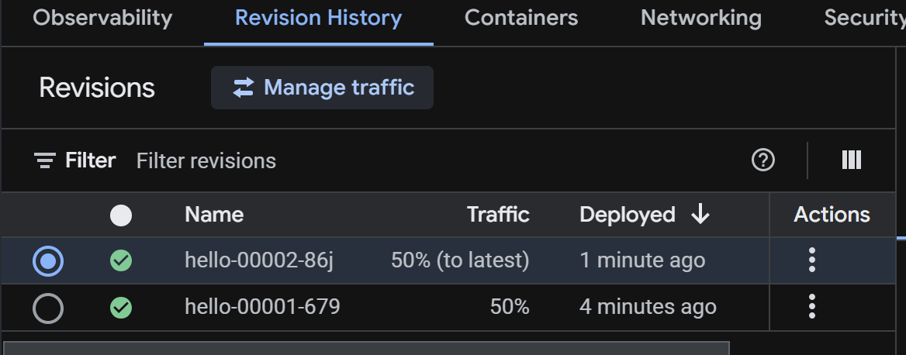
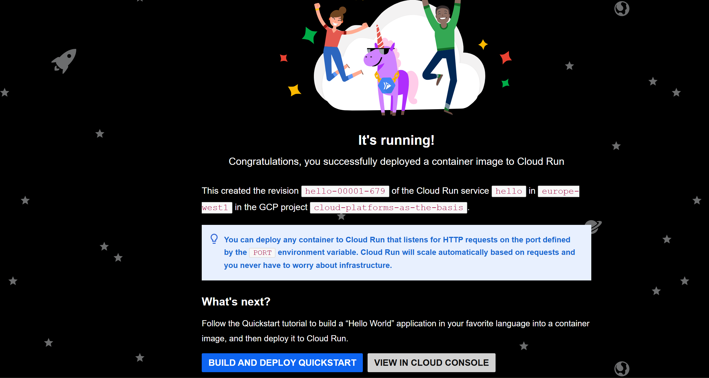

# Отчет по лабораторной работе №2 "Исследование Cloud Run"

## Подготовка

Создаем Compute service из дефолтного темплейта hello

Открываем его ссылку, проверяем работоспособность

## Работа с сервисом

Смотрим метрики и логи сервиса сразу после его запуска

Меняем порт и перезапускаем сервис, видим что изменилось название ревизии как в гугл клауд, так и по ссылке 

Разделяем трафик пополам между первой и второй ревизией

Видим что в меню ревизий трафик разделился

И что на некоторые переходы открывается первая ревизия вместо второй 

