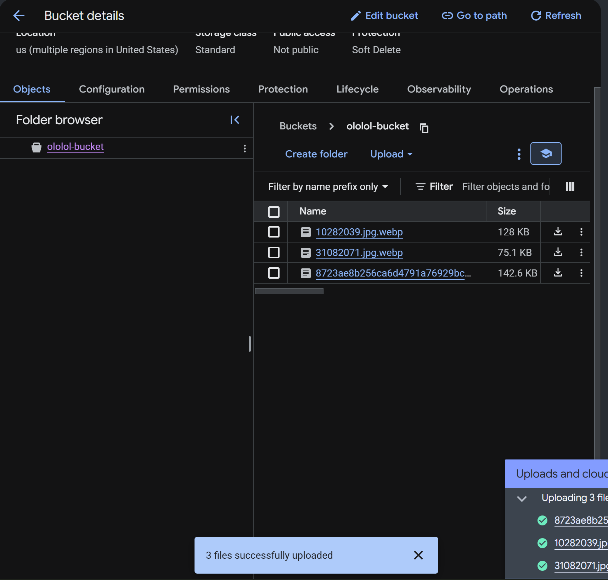
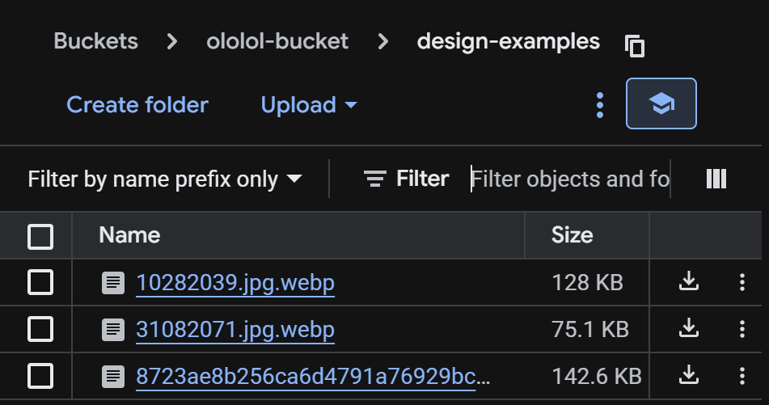
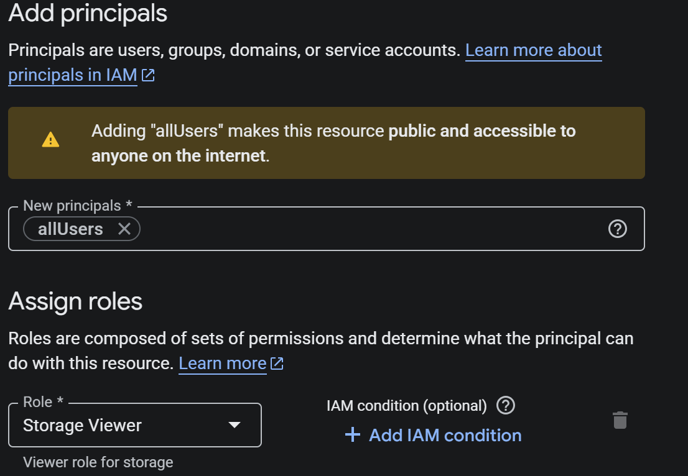
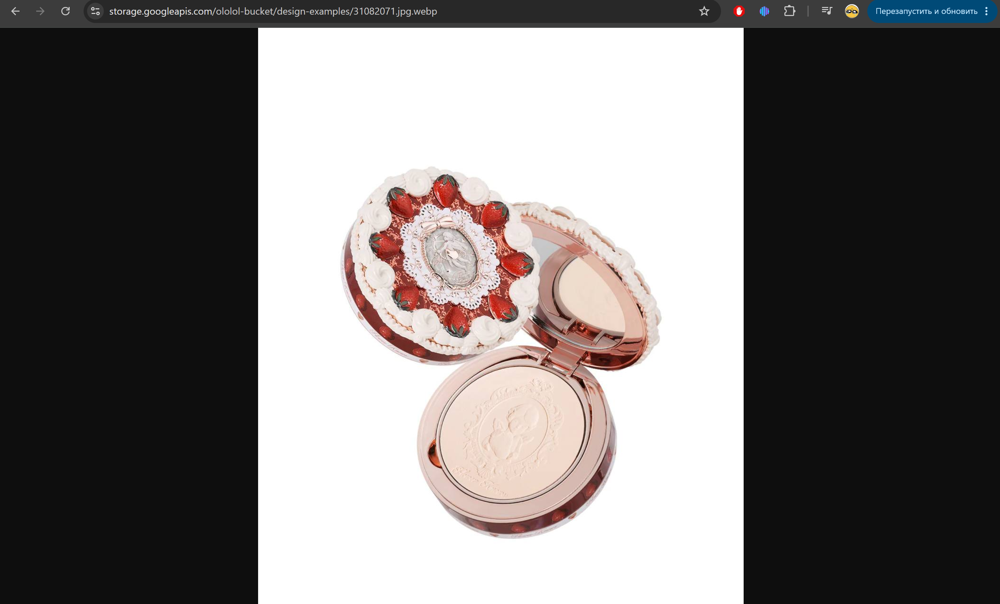

# Отчет по лабораторной работе №3 "Исследование Cloud Storage"

## Подготовка

Создаем бакет и грузим в него три картинки

## Работа с бакетом

Создаем папку внутри бакета и перемещаем туда все картинки

Делаем бакет публичным

И переходим на публичную ссылку изображения

