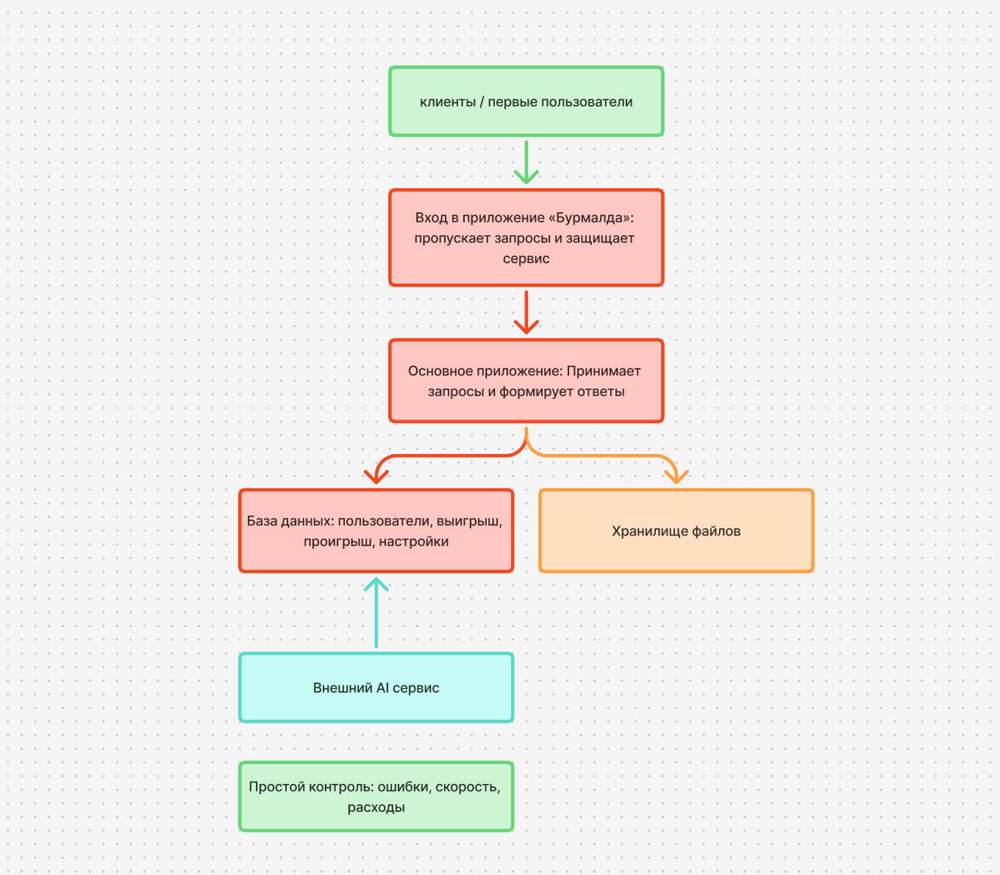
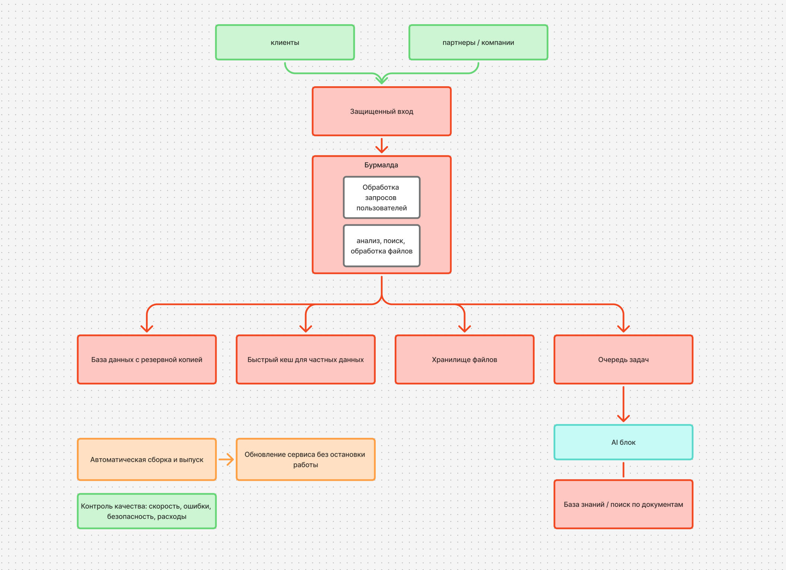
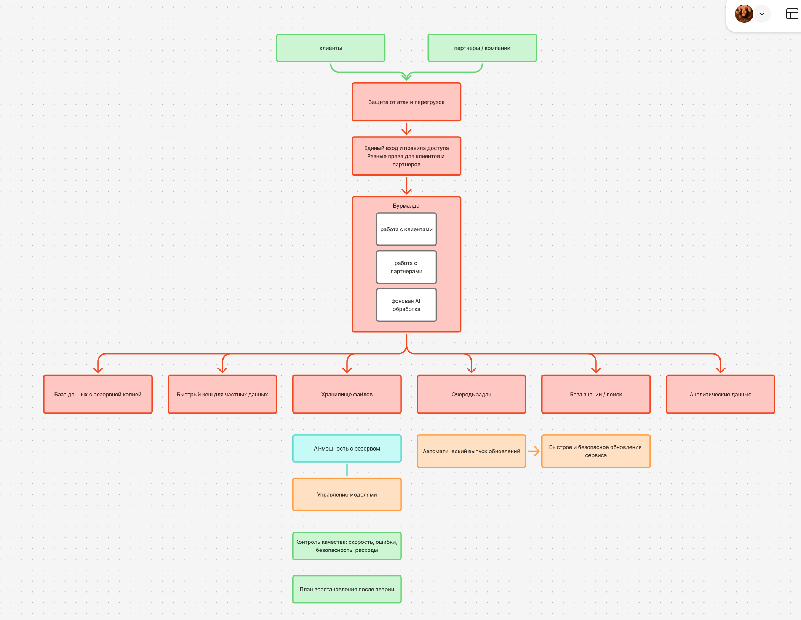

# Отчет по лабораторной работе №4 "Разработка инфраструктуры MVP AI приложения"

## Первое состояние - начальное 

### Экономическая модель

| Статья расходов | Что входит | Сумма, ₽/мес | Почему это нужно |
|---|---|---:|---|
| Вход в сервис | Приём запросов, базовая защита | 5 000 | Чтобы сервис не принимал вредоносные или избыточные запросы |
| Работа приложения | Небольшой сервер для обработки запросов | 15 000 | Достаточно для первых пользователей и проверки идеи |
| База данных | Хранение пользователей, заказов и настроек | 18 000 | Данные должны сохраняться даже после перезагрузки сервиса |
| Хранилище файлов | Документы, изображения, результаты | 3 000 | Не нужно хранить большие файлы внутри базы данных |
| AI-запросы | Оплата внешнего AI по факту использования | 20 000 | Не нужно сразу покупать дорогое оборудование для AI |
| Контроль работы | Ошибки, скорость, оповещения | 6 000 | Позволяет заметить проблему до жалоб пользователей |
| Поддержка | Частичная работа инженера | 40 000 | Кто-то должен следить за работой и обновлениями |
| **Итого в месяц** |  | **107 000** | Минимальный вариант для проверки спроса |

## Второе состояние - тестирование партнерами 

### Экономическая модель

| Статья расходов | Что входит | Сумма, ₽/мес | Почему это нужно |
|---|---|---:|---|
| Защита и доступ партнёров | Отдельные ключи и правила для компаний | 20 000 | Партнёры должны подключаться безопасно и не мешать друг другу |
| Рабочая платформа | Система, которая выдерживает рост нагрузки | 130 000 | Если один блок перегружен, сервис продолжает работать |
| База данных с копией | Основная база и её резервная копия | 85 000 | Если основной сервер сломается, данные не будут потеряны |
| Быстрый кэш | Хранение частых ответов рядом с сервисом | 35 000 | Сервис отвечает быстрее и меньше нагружает базу |
| Очередь задач | Тяжёлые задачи выполняются по очереди | 30 000 | Обработка файлов не замедляет работу обычных пользователей |
| Хранилище файлов | Активные файлы и старые данные | 25 000 | Старые данные можно хранить дешевле |
| AI-запросы и вычисления | Внешний AI и небольшая GPU-машина | 320 000 | Часть задач выполняется внутри компании, пики — через внешний AI |
| Обновления и безопасность | Автоматическое обновление и хранение паролей | 35 000 | Обновления проходят без остановки сервиса |
| Контроль работы | Мониторинг скорости, ошибок и расходов | 40 000 | Можно заранее увидеть сбой или перерасход |
| Поддержка | Частичная команда инженеров | 180 000 | Сервис должен стабильно работать для партнёров |
| **Итого в месяц** |  | **870 000** | Вариант для первых корпоративных клиентов |

## Третье состояние - продовое решение 

### Экономическая модель

| Статья расходов | Что входит | Сумма, ₽/мес | Почему это нужно |
|---|---|---:|---|
| Защита от атак | Защита от вредоносного трафика и перегрузок | 80 000 | Атака не должна остановить работу сервиса |
| Основная платформа | Сервис работает в нескольких зонах | 300 000 | Если одна зона недоступна, клиенты продолжают работать |
| Надёжная база данных | Основная база и резервные копии | 220 000 | Данные сохраняются, а сервис быстро восстанавливается |
| Быстрый кэш и очередь | Быстрые ответы и фоновые задачи | 160 000 | Пользователи не ждут завершения тяжёлых операций |
| Хранилище и поиск | Файлы, архивы и база знаний | 160 000 | Быстрый поиск по актуальным данным и дешёвое хранение архивов |
| AI-мощность с резервом | Основной и резервный GPU | 700 000 | Если один блок сломается, AI-функции продолжат работать |
| Резервный внешний AI | Внешний AI для пиковых нагрузок | 80 000 | Сервис не останавливается при резком росте запросов |
| Контроль и реагирование | Мониторинг, оповещения, разбор инцидентов | 90 000 | Проблемы обнаруживаются до обращения клиентов |
| Поддержка | Инженеры, которые поддерживают сервис | 400 000 | Обеспечивает стабильность, обновления и устранение сбоев |
| **Итого в месяц** |  | **2 190 000** | Вариант для масштабируемого сервиса с высоким SLA |